# Verification: rollout and rollback

A one-line fix (`1.4.0` → `e.g. 1.4.0` in the New release dialog) shipped to prod as 0.1.2 under traffic, then rolled
back to 0.1.1 with `scripts/rollback.sh`. `scripts/rollout_check.py` ran during both: 0 failed requests.

## Before: 0.1.1

Prod runs 0.1.1. The Version field shows `1.4.0`, which looks like a prefilled value. The release `1.2.3 Rollout demo`
was created before the rollout and stays in the list throughout.

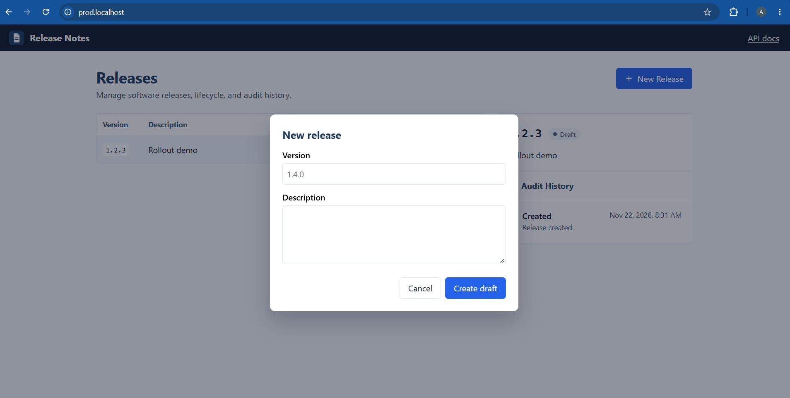

The prod Application in Argo CD: chart 0.1.1 from GHCR (OCI), values from `kind-gitops`, automated sync with prune
and self-heal.

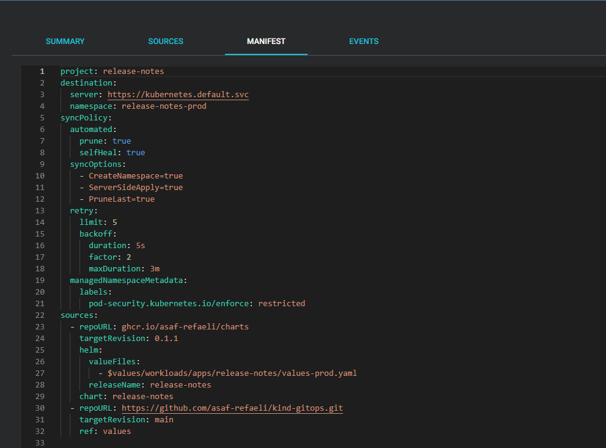

## Ship 0.1.2

The fix PR (#43): all CI checks pass on the pull request. The main-only jobs (push, release, update-gitops) are skipped.

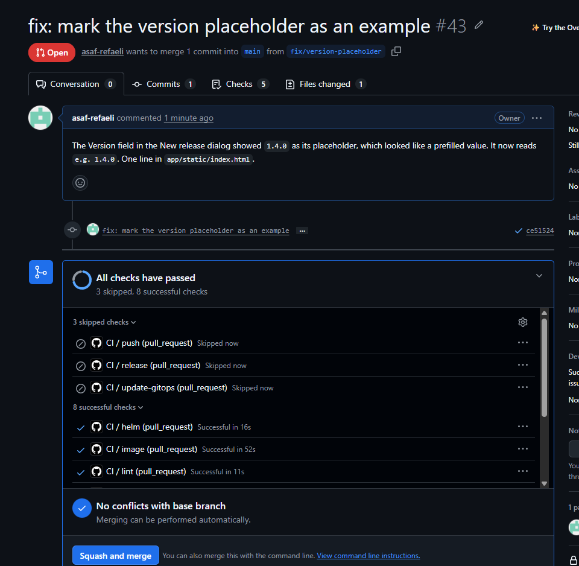

After the merge, CI on `main` builds and pushes the image, and the `release` job opens the release PR. update-gitops
is skipped: nothing deploys until the release PR is merged.

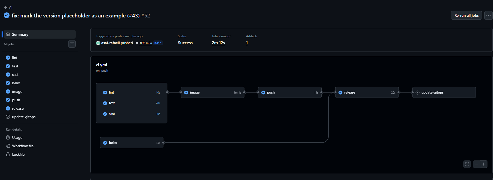

release-please opens the release PR for 0.1.2. On release PRs the source and image checks are skipped; the tested
image is reused.

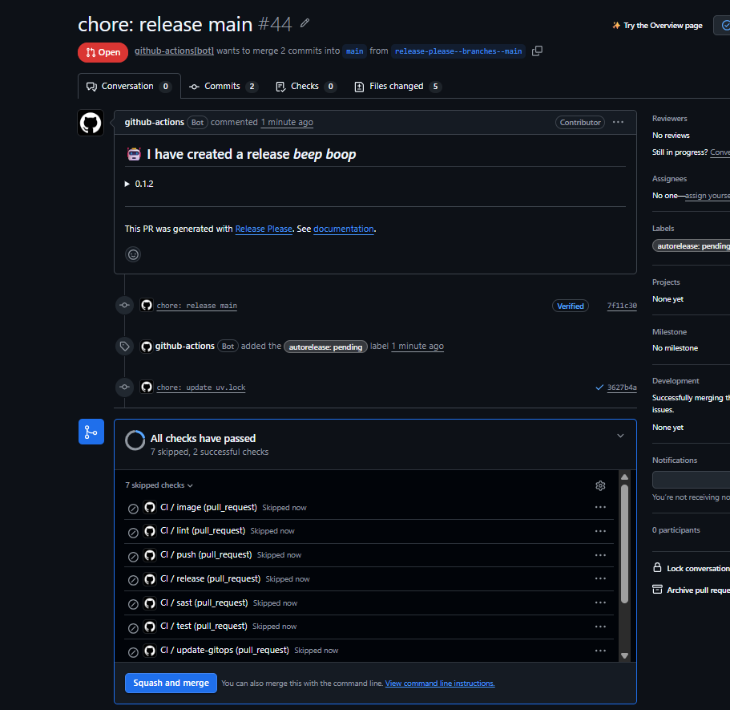

The release PR bumps the app version in `pyproject.toml`, `Chart.yaml` (`appVersion`) and the manifest, and adds the
changelog entry. The chart version stays 0.1.1.

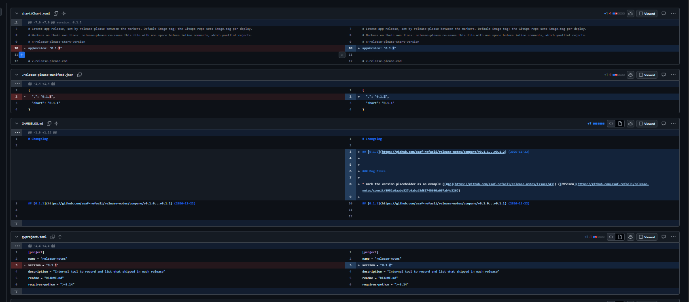

Merging the release PR runs `release` (tags the tested digest as 0.1.2) and `update-gitops` (commits the new tag and
digest to `kind-gitops`). No rebuild.

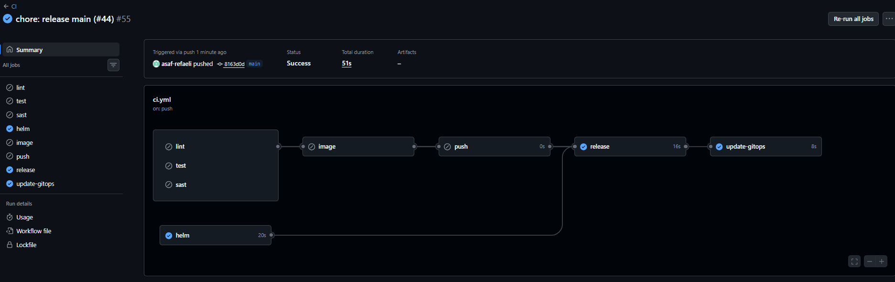

## Upgrade under traffic: 0 failed

Argo CD synced the commit: prod runs `release-notes:0.1.2`, pinned by digest.

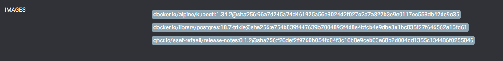

The checker ran 300 s through Traefik during the sync: 6196 rounds, 0 failed. 0.1.1 answered until 244 s, 0.1.2 from
148 s: both versions served side by side during the rolling update.

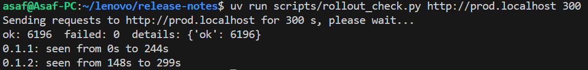

The new version is live: the field now reads `e.g. 1.4.0`.

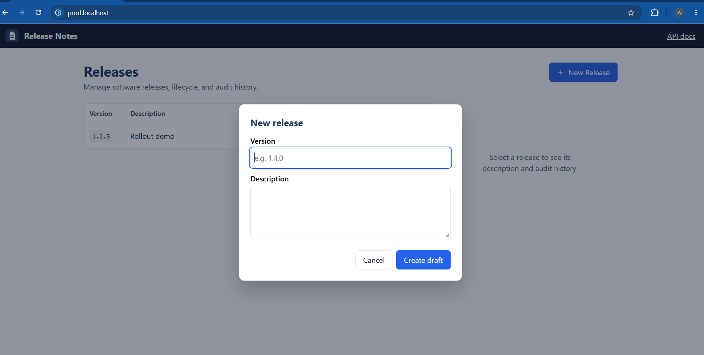

## Rollback under traffic: 0 failed

Before the rollback: 0.1.2 is serving, and a second release, `1.2.4 Rollback demo`, was added.

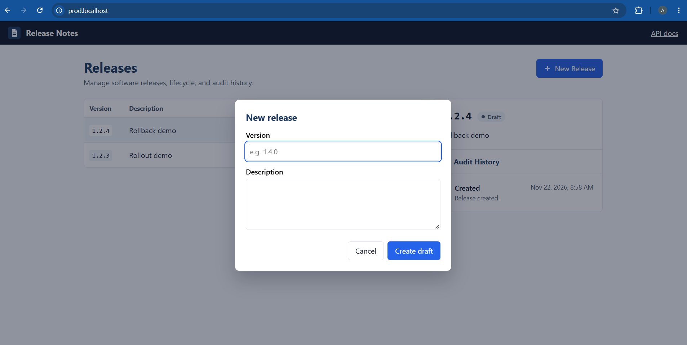

`kind-gitops/scripts/rollback.sh` reverts the 0.1.2 deploy commit through a PR (#10) and merges it. Argo CD syncs the
previous tag and digest.

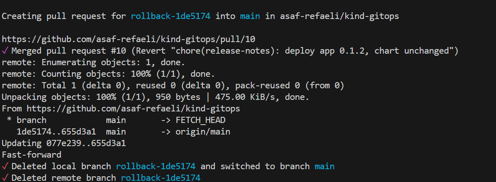

Prod runs `release-notes:0.1.1` again, the same digest as before the upgrade.

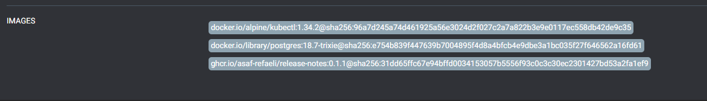

The checker ran 400 s during the rollback: 16135 rounds, 0 failed. 0.1.2 answered until 194 s, 0.1.1 from 125 s.

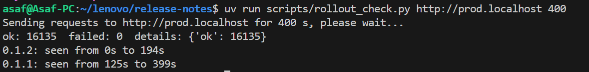

The old placeholder `1.4.0` is back, and both demo releases are still there: the database was not touched.

